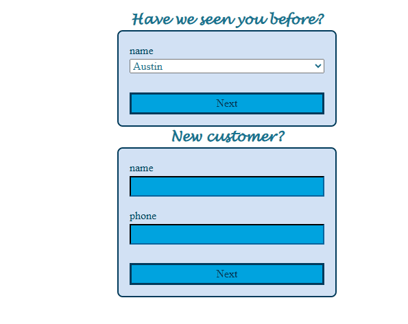
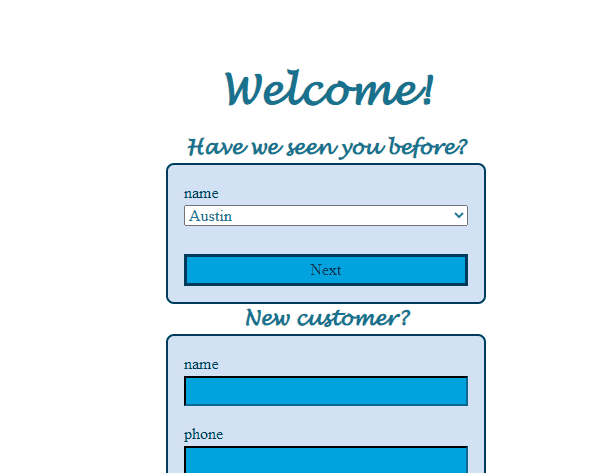
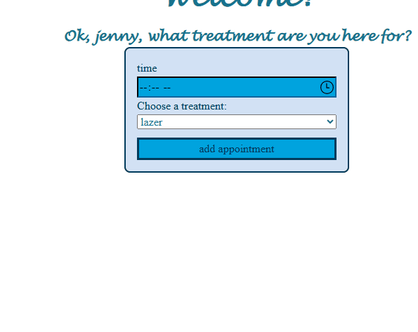
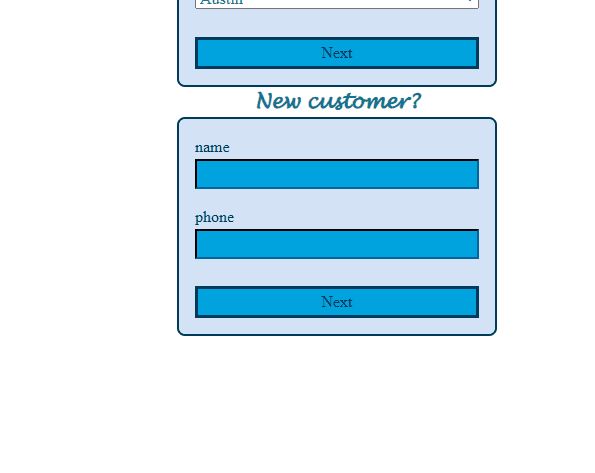
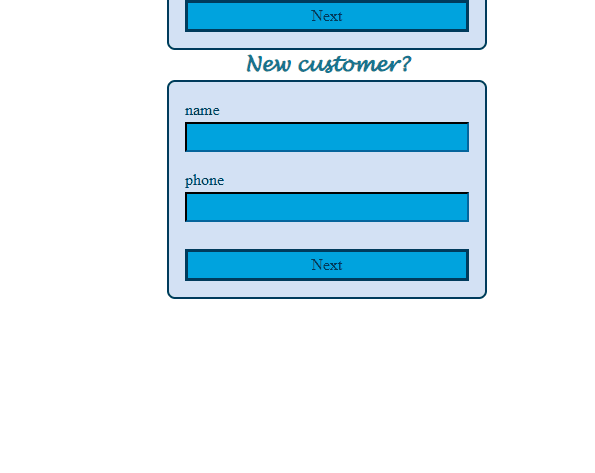

# Sprint 3 - Developing a Minimum Viable Product (MVP)

## Sprint Goals

Continue to develop the web application to the point that it provides all key functionality of the system. Test and refine it so that it can serve as the basis for the final phase of development.

### Specific Goals

**Edit these goals as needed**

- Create the following web pages:
    - Form for ...
    - Etc.
- Develop SQL database queries to:
    - Add a new ...
    - Etc.

## Testing going from form to list

i am testing the add appointment button it should take me to the lsit of opintments

**PLACE SCREENSHOTS AND/OR ANIMATED GIFS OF THE TESTING HERE**

### Changes / Improvements

i had to post the list for some reson but it finaly got me to the list and i add a new preson list and been here befor list with a date and what tretment list has well

**PLACE SCREENSHOTS AND/OR ANIMATED GIFS OF THE IMPROVED SYSTEM HERE**

## Testing showing opintments

i am testing that the appointment shows the one i just added and all the other ones

**PLACE SCREENSHOTS AND/OR ANIMATED GIFS OF THE TESTING HERE**

### Changes / Improvements

we made a new qurray called treatment/new added the time and treatment and the hiddin cust_id and made it so that it wont get confuised with the bookings_id and preson_id

**PLACE SCREENSHOTS AND/OR ANIMATED GIFS OF THE IMPROVED SYSTEM HERE**

## Testing teel new cust they be added to are data base

i what to let the new cust that they are now in are data base with a little messege

**PLACE SCREENSHOTS AND/OR ANIMATED GIFS OF THE TESTING HERE**

### Changes / Improvements

we put a little flash messge saying they have been added succsfuly to the data base

**PLACE SCREENSHOTS AND/OR ANIMATED GIFS OF THE IMPROVED SYSTEM HERE**

## ETC...

## Sprint Review

this sprint has helped the progic go far forwords with new things and getting things working like a old custmer and new custmore form and getting the list to show most of the stuff would break or not show but i got throw and did it

