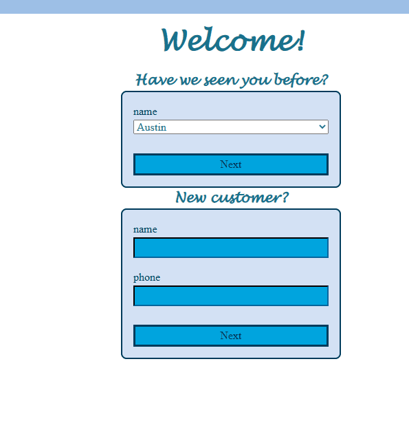
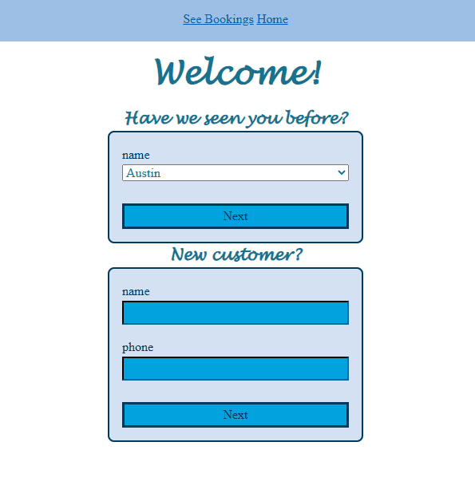

# Sprint 4 - Developing a Refined and Complete System

## Sprint Goals

Develop the system until it is fully featured, with a refined UI and it satisfies the requirements. The system will be fully tested at this point.

### Specific Goals

**Edit these goals as needed**

- Refine the design and UI of the website
- Refine the user experience (UX) of the system
- Perform final, full-system testing

## Aesthetics

i put some blue colors to match tcc witch looks ok but some of the stuff was not readable and it look like colors were missing

### Changes / Improvements

i have keeped the same colors for my website i have used colors that look like the comedic clinic and with some that aren't there to make some stuff pop more and everything is readable
**PLACE SCREENSHOTS AND/OR ANIMATED GIFS OF THE IMPROVED SYSTEM HERE**

## uesbuilty

i had it so there was one way to enter ur name and phone treatment and time but not a way to know who was all ready there

### Changes / Improvements

i change it so that there was see bookings and a home button at the top and for the from there are now if u been here and if u new person then after that they both take you to a from that ask what time and what you want

**PLACE SCREENSHOTS AND/OR ANIMATED GIFS OF THE IMPROVED SYSTEM HERE**

## Testing  End User

with colors i think they look great but did need some changes and it dose have what my mum wanted it to have with some other stuff need to be added

### Changes / Improvements

i added what need to go in and it would be something that would be easy for the tcc workers to use

**PLACE SCREENSHOTS AND/OR ANIMATED GIFS OF THE IMPROVED SYSTEM HERE**

## ETC...

## Sprint Review

Replace this text with a statement about how the sprint has moved the project forward - key success point, any things that didn't go so well, etc.

